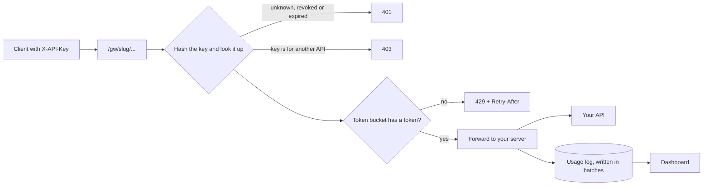

<p align="center">
  
</p>

Gatecraft is a small API gateway with API keys, per-key rate limiting and a usage dashboard.
I built it as a student project to learn how real gateways work: you register an API,
hand out keys, and every request to `/gw/your-api/...` is checked, limited, forwarded
and logged.


## What it does

- **Sign up and manage APIs.** Add the server you want to protect and get a gateway address like `/gw/weather`.
- **Issue API keys.** Each key has its own burst size and refill rate. The full key is shown once and only a hash is stored.
- **Rate limit every key** with a token bucket. Callers get `X-RateLimit-Remaining` headers, and a `429` with `Retry-After` when they run out.
- **Revoke instantly.** A revoked key gets a `401` on its very next request.
- **See what happened.** The dashboard shows requests over time, success and failure counts, busiest paths and the latest requests.

## How a request flows



If the upstream refuses the connection the client gets `502`, and if it is too slow, `504`.

## Tech

| Part | What I used |
| --- | --- |
| Backend | Java 21, Spring Boot 3.3, Spring Security, Spring Data JPA |
| Database | MySQL 8 with Flyway migrations |
| Auth | JWT (HS256) for the dashboard, BCrypt for passwords |
| Caching | Caffeine, for key lookups |
| Frontend | JavaScript (JSX), React 19, Vite, React Router 7, Recharts, plain CSS |
| Tests | JUnit 5, Mockito, Spring Boot Test (105 tests) |

## Run it on your machine

You need Java 21, Node 20+ and a local MySQL 8 server.

**1. Backend.** In PowerShell, from the `backend` folder:

```powershell
$env:DB_URL = "jdbc:mysql://localhost:3306/api_gateway?createDatabaseIfNotExist=true&useSSL=false&allowPublicKeyRetrieval=true"
$env:DB_USERNAME = "root"
$env:DB_PASSWORD = "your-mysql-password"
$env:JWT_SECRET = [Convert]::ToBase64String((1..48 | ForEach-Object { Get-Random -Maximum 256 }))
.\mvnw.cmd spring-boot:run
```

The variables only last for that PowerShell window. Spring Boot does not read `.env` files.
When it works you will see `Started GatewayApplication`, and
`http://localhost:8080/actuator/health` returns `UP`.

**2. Frontend.** In a second window, from the `frontend` folder:

```powershell
npm install
npm run dev
```

Open http://localhost:5173. You land on the home page. Choose "Create account" to sign up, and you will be taken to the Overview page.

## Try it in two minutes

1. Add an API with the slug `demo` that forwards to `https://httpbin.org`.
2. Create a key with a burst size of 5 and 1 request per second. Copy it, because you only see it once.
3. Call the gateway ten times:

```powershell
1..10 | ForEach-Object { curl.exe -s -o NUL -w "%{http_code}`n" -H "X-API-Key: YOUR_KEY" http://localhost:8080/gw/demo/get }
```

You should see five `200`s and then `429`s. Open the API's Overview tab to see them on the chart, or the main Overview page for the totals across all your APIs.
Click Revoke on the key and run the call again: it returns `401` straight away.

## API overview

| Area | Endpoints |
| --- | --- |
| Account | `POST /api/auth/register`, `POST /api/auth/login`, `GET /api/auth/me` |
| APIs | `GET/POST /api/apis`, `GET/PATCH/DELETE /api/apis/{id}` |
| Keys | `GET/POST /api/apis/{id}/keys`, `PATCH /api/keys/{id}`, `POST /api/keys/{id}/revoke` |
| Analytics | `GET /api/analytics/summary`, `timeseries`, `top-paths`, `keys`, `recent` |
| Gateway | `ANY /gw/{slug}/**` with an `X-API-Key` header |

The reasoning behind the main choices is in [`docs/DESIGN.md`](docs/DESIGN.md).

## Security choices

- Passwords are hashed with BCrypt. Login attempts are limited to 5 per minute per IP.
- API keys are random 256-bit values. Only a SHA-256 hash is stored, and the full key is shown once.
- Every query is scoped to the signed-in user. Asking for someone else's API or key returns `404`.
- Upstream URLs are checked to stop SSRF. Localhost, private and link-local addresses are rejected.
- Missing, wrong, revoked and expired keys all return the same `401`, so nothing leaks.
- Request bodies are capped at 1 MB. The app refuses to start if `JWT_SECRET` is shorter than 32 bytes.

## A bug the tests caught

My first version of the rate limiter checked for a bucket and then created one in two separate steps.
Under heavy parallel load two threads could each create a bucket for the same key and hand out too many
requests. The concurrency test failed (it expected 50 allowed and got 79). I fixed it by making the
lookup and the creation one atomic operation with `ConcurrentHashMap.compute`. The test now passes.

## Project layout

```
backend/    Spring Boot app, organised by feature (auth, apis, keys, gateway, ratelimit, usage, analytics)
frontend/   React dashboard
docs/       Design notes
```

## Limits and next steps

- **One server only.** Rate limit buckets live in memory, so running several copies would give each key several limits. Fixing this properly means moving the buckets to something shared like Redis.
- **Usage logs are written in batches.** If the queue is full, events are dropped and counted on the health endpoint.
- **No load test yet.** I have not measured how many requests per second it handles, so I am not quoting any numbers.
- The frontend has a home page, a docs page, an overview across all your APIs, and a page for each API.
- Next: run the load test and share the rate limit counters between servers.
